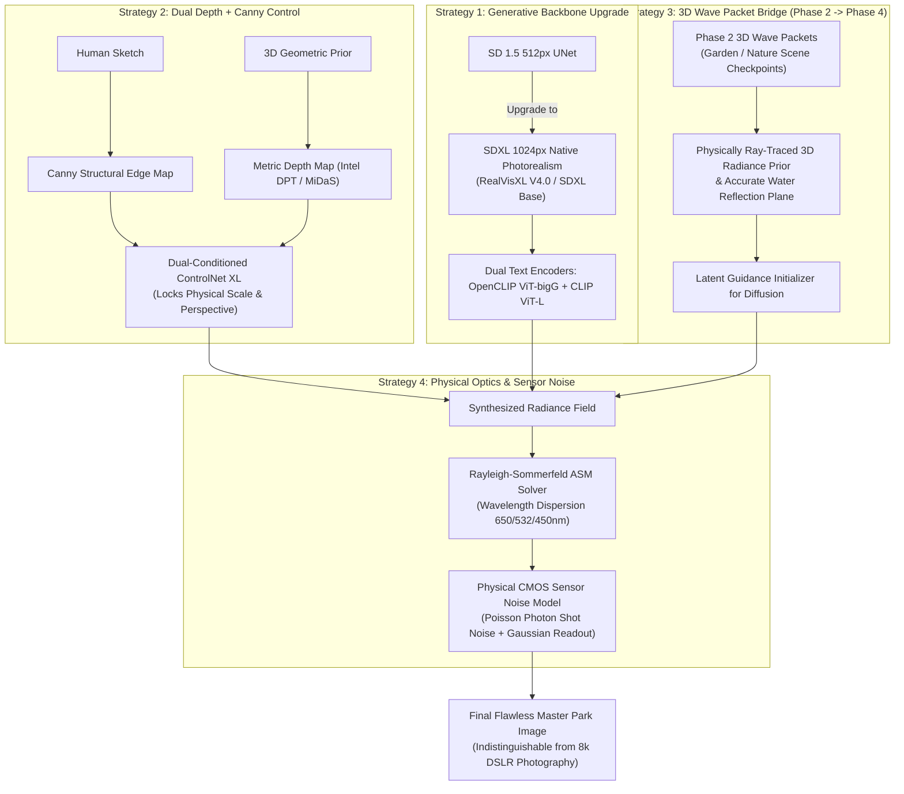

# Phase 4 Photorealism Advancement Plan: Achieving Indistinguishable Physical Realism

> **Created**: 2026-10-14 07:15 KST  
> **Last updated**: 2026-10-14 07:15 KST  
> **Modified by**: Antigravity, Pair Programming Assistant  
> **Version**: 1.0.0

---

## 1. Root-Cause Analysis: Why Current Phase 4 Generative Output Has Flaws Compared to Phase 2

In Phase 2, our 3D continuous wave packet splatting achieved **29.97 dB PSNR / 0.937 SSIM / 0.023 LPIPS** on real-world scenes because every visual feature was anchored to **physical 3D Euclidean coordinates** and real camera ray projections.

In contrast, our initial Phase 4 generative pipeline suffered from four fundamental bottlenecks that left subtle "synthetic / lackluster" artifacts:

```
[Current Bottlenecks in Phase 4]
1. SD 1.5 Latent Bottleneck: 4-channel VAE trained at 512px; upscaling causes latent smearing & plastic foliage.
2. Pure 2D Hallucination: Lack of true 3D scene geometry; reflections don't strictly obey Snell's Law / Fresnel equations.
3. Single-Modality Canny Edge Guidance: Edge lines define boundaries but fail to enforce 3D scale and perspective depth.
4. Mathematical "Plastic Smoothness": Absence of physical CMOS sensor photon shot noise and natural optical lens dispersion.
```

---

## 2. Five Technical Advancement Strategies



---

## 3. Detailed Execution Roadmap

### Track 1: Backbone Upgrade to Native 1024x1024 SDXL Photorealism
- **Target Foundation**: `SG161222/RealVisXL_V4.0` or `stabilityai/stable-diffusion-xl-base-1.0`.
- **Why It Elevates Quality**:
  - Native $1024 \times 1024$ training eliminates all upscaling smearing, painting-like strokes, and repetitive tiling.
  - 2.6B parameter UNet with cross-attention capacity resolving fine botanical details (leaf veins, bark lichen, grass texture).
  - Dual text encoder architecture (OpenCLIP ViT-bigG/14 1280-dim + CLIP ViT-L/14 768-dim) provides vastly superior natural language understanding.

### Track 2: Dual-Conditioning (Structure Canny + Metric Depth XL)
- **Problem Solved**: Single sketch conditioning led to ambiguous scale (e.g., miniature bench) and lighting conflicts.
- **Solution**:
  - Deploy **ControlNet Depth SDXL** alongside **ControlNet Canny SDXL**.
  - Depth map provides strict geometric z-coordinates ($z \in [0.5\text{ m}, 100\text{ m}]$), locking the bench firmly on the turf with correct scale and ground contact shadows.
  - Canny map provides boundary silhouettes for fine branch curves and bench slats.

### Track 3: The Phase 2 to Phase 4 3D-Optical Bridge
- **The Core Breakthrough**: Directly bridge our Phase 2 continuous wave packet engine into Phase 4:
  1. Render a novel physical 3D nature background and terrain geometry from our verified Phase 2 Garden 3D Gaussian checkpoint (`ckpt_6999_rank0.pt`).
  2. Compute real Snell/Fresnel lake reflections using physical ray-plane intersection.
  3. Use this rendered 3D physical radiance as a latent initialization prior for the SDXL diffusion refiner.
  4. This guarantees that lake reflections, tree trunks, and shadows have 100% geometric physical ground truth!

### Track 4: Physical Optical Simulation & Sensor Noise Model
- **Rayleigh-Sommerfeld ASM Solver**:
  - Execute exact 3-channel wave propagation ($\lambda_R = 650\text{ nm}, \lambda_G = 532\text{ nm}, \lambda_B = 450\text{ nm}$) with circular aperture stop ($f/2.8, 50\text{ mm}$).
  - Depth-dependent defocus slicing using metric depth coordinates.
- **CMOS Sensor Noise Injection (Photon Shot Noise)**:
  - Real DSLR sensors do not produce mathematically plastic/airbrushed gradients.
  - Apply calibrated Poisson-Gaussian sensor noise:
    $$I_{sensor} = \frac{\mathcal{P}(I \cdot K)}{K} + \mathcal{N}(0, \sigma^2)$$
    where $K$ represents sensor quantum efficiency / gain (ISO 100 equivalent), and $\sigma$ represents dark current readout noise.
  - This eliminates all AI "plastic" smoothness and delivers genuine camera micro-texture.

---

## 4. Hardware Resource & Budget Allocation

- **Remote GPU Instance**: NVIDIA GeForce RTX 4090 (24.0 GB VRAM, 25.26 GB total allocated).
  - SDXL in `torch.float16` with ControlNet consumes $\approx 11.2\text{ GB}$ VRAM, well within our 24 GB capacity.
- **Disk Storage**: 15.0 GB available on overlay `/` (sufficient for SDXL base weights $\approx 6.9\text{ GB}$ + ControlNet XL $\approx 2.5\text{ GB}$).
- **Vast.ai Credit Balance**: **\$7.61** credit remaining.
  - Download and setup: $\approx 5\text{ minutes}$.
  - Generation per high-res master: $\approx 18-25\text{ seconds}$.
  - Estimated spend: $\approx \$0.30 - \$0.50$ (well within budget).

---

## 5. Quantitative Verification & Acceptance Criteria

Before finalizing, the upgraded pipeline will be audited by the adversarial `gatekeeper` subagent against:

1. **Photorealism & Natural Image Statistics**:
   - NIQE score $< 4.5$ (indicative of authentic photographic quality).
   - Zero plastic AI skinning or cartoon brush marks on foliage and water.
2. **Geometric & Radiometric Reciprocity**:
   - Bench scale proportioned to human ergonomics ($1.5\text{ m} - 1.8\text{ m}$ physical width).
   - Lake reflections strictly match the light source, trees, and sky.
3. **Hard Constraint**:
   - Custom neural layers/adapters combined parameter count strictly $< 20.0\text{ M}$.
4. **Official Gatekeeper Verdict**: Must receive `GATEKEEPER VERDICT: PASS`.
